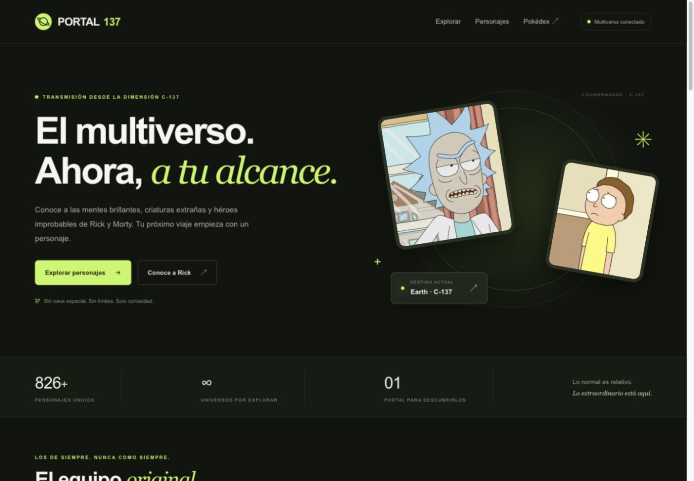
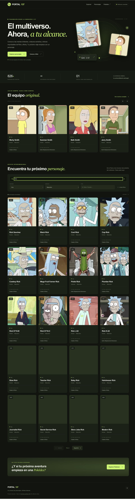
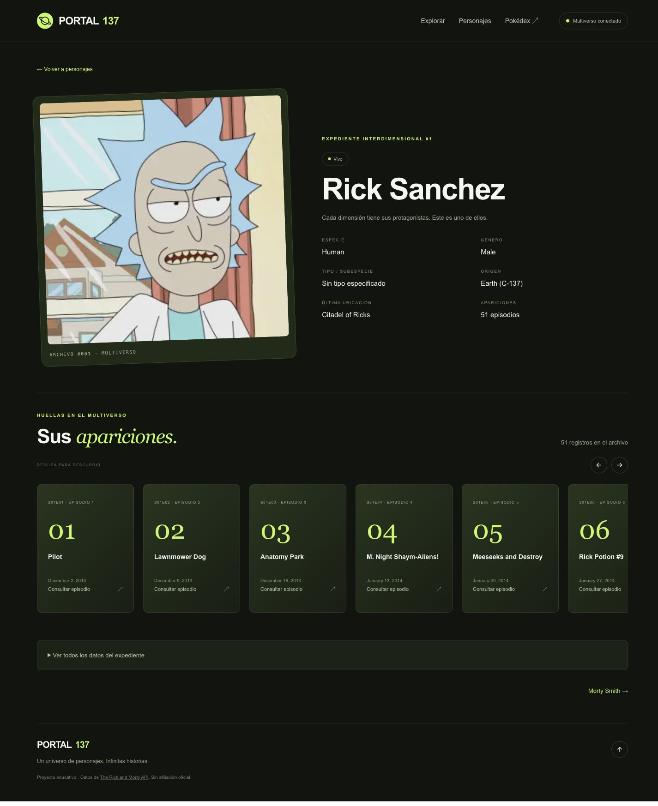

# Tarea · Aplicación de Rick y Morty

Se desarrolló Portal 137 en el mismo proyecto del laboratorio, manteniendo la Pokédex. La portada combina una presentación animada, personajes destacados en carrusel y un explorador con filtros.

## Cumplimiento de la consigna

| Requisito                               | Implementación                                                                                     |
| --------------------------------------- | -------------------------------------------------------------------------------------------------- |
| Listado SSR                             | Portada `/`, con `connection()` y datos obtenidos en el servidor.                                  |
| Forzar caché y demostrar SSG            | `cache: 'force-cache'` en la consulta y catálogo estático `/personajes`.                           |
| Lazy loading                            | Imágenes de tarjetas con `next/image` y `loading='lazy'`.                                          |
| Búsqueda CSR                            | `useState`, `useEffect`, debounce y cancelación de peticiones.                                     |
| Filtros name, status, type y gender     | Los cuatro campos funcionan juntos y se envían al proxy de la API.                                 |
| Detalle completo                        | Se mapean todos los campos del personaje, incluidas URLs anidadas, episodios y fecha del registro. |
| Rutas estáticas de todos los personajes | 826 rutas por ID mediante `generateStaticParams`; se recorre la paginación completa.               |
| ISR de diez días                        | `revalidate = 864000` en catálogo y detalle, más el intervalo en las peticiones cacheadas.         |
| async / await                           | Usado en servicios, páginas, metadata y búsquedas.                                                 |
| Interfaz con Tailwind CSS               | Tailwind CSS 4 y estilos globales complementarios para la identidad visual y animaciones.          |
| Animaciones y carruseles                | Retratos flotantes, órbitas, entrada de tarjetas y carruseles de personajes y episodios.           |
| Justificación de estrategias            | Tabla y explicación detalladas en el README.                                                       |

## Capturas

### Portada

### Filtros combinados

### Detalle y episodios

### Vista móvil

## Resultado de las pruebas

El build genera 984 páginas en total, incluidas las 826 fichas de personajes, las 151 de Pokémon y rutas estáticas adicionales. La portada figura como dinámica (SSR); el catálogo y los detalles de Rick y Morty muestran revalidación de 10 días. Lint y auditoría de dependencias completaron sin errores ni vulnerabilidades conocidas en la ejecución registrada.

Se verificaron filtros individuales y combinados, segunda página, resultados vacíos, entradas inválidas, página 404 y cabeceras de seguridad. No se esperaron diez días: el intervalo se verificó en el manifiesto de producción.

## Enlaces

Repositorio: https://github.com/luisdionicio-lgtm/FRONTEND_SEMANA10

Aplicación en Vercel: https://frontend-semana10.vercel.app

El despliegue de producción finalizó con estado READY. Se verificó el acceso público y se ejecutaron las pruebas funcionales sobre la URL de producción; los resultados están en `production-verification.txt`.

## Cinco conclusiones para revisión personal

1. Separar el renderizado de la página y la caché de datos permite usar SSR en la portada sin consultar la API en cada visita.
2. SSG resulta apropiado para las fichas porque su contenido cambia poco y puede prepararse durante el build; ISR permite renovarlo después de diez días sin reconstruir todo el proyecto manualmente.
3. La búsqueda con hooks evita recargas y mejora la interacción. El debounce y la cancelación de solicitudes reducen llamadas y evitan que una respuesta anterior reemplace una búsqueda reciente.
4. Consultar todas las páginas de la API fue necesario para generar los 826 detalles. Usar solamente la primera página habría dejado incompleta la tarea.
5. Una interfaz atractiva también debe ser accesible y verificable: por eso se incluyeron navegación por teclado, reducción de movimiento, estados de error y pruebas antes de publicar el código.
